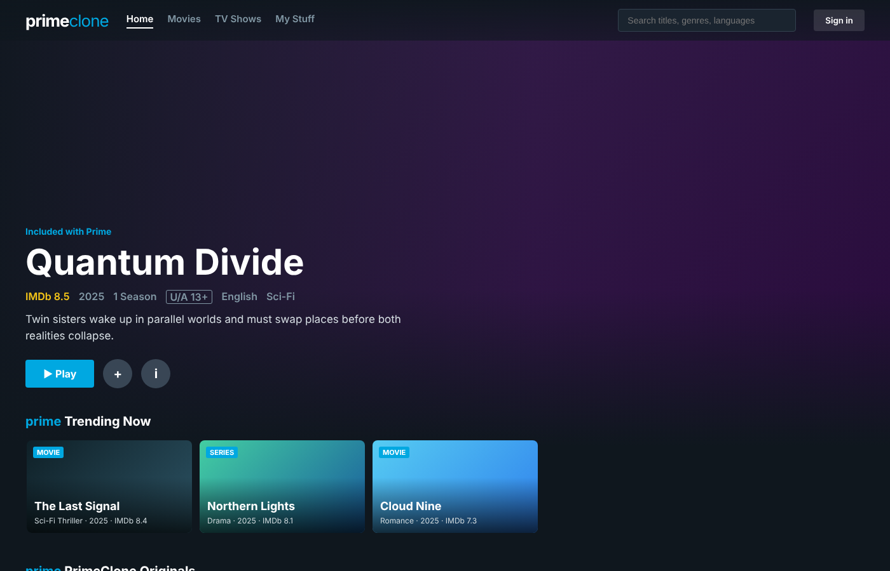

# PrimeClone — 3-Tier Streaming App on Azure DevOps + AKS

A Prime Video–style website built to teach the **complete DevOps flow**:

> **Code → Docker images → Azure Container Registry → Azure DevOps Pipeline → AKS → Public URL**

| Tier | Tech | Folder | Docker image |
|------|------|--------|--------------|
| 1. Frontend | HTML / CSS / JavaScript served by **nginx** | `frontend/` | `primeclone-frontend` |
| 2. Backend  | **Node.js + Express** REST API (JWT login) | `backend/` | `primeclone-backend` |
| 3. Database | **MySQL 8** with schema + seed data | `database/` | `primeclone-mysql` |



---

## 1. The big picture (explain this first)

```
                         ┌──────────────────────── AKS cluster (namespace: primeclone) ───────────────────────┐
                         │                                                                                     │
  Browser ──HTTP:80──▶ [Service: frontend]  ──▶  frontend pods (nginx x2)                                    │
  (Public IP)            │  type LoadBalancer          │                                                       │
                         │                             │  /api/*  (reverse proxy)                              │
                         │                             ▼                                                       │
                         │                    [Service: backend]  ──▶  backend pods (Node.js x2)              │
                         │                      type ClusterIP              │                                  │
                         │                                                  │  SQL :3306                       │
                         │                                                  ▼                                  │
                         │                    [Service: mysql]   ──▶  mysql-0 pod (StatefulSet)               │
                         │                      headless                    │                                  │
                         │                                                  ▼                                  │
                         │                                         Azure Managed Disk (PVC 5Gi)                │
                         └─────────────────────────────────────────────────────────────────────────────────────┘
```

### How one click travels through the system
Example: the student clicks a movie and presses **+ Watchlist**.

1. **Browser** sends `POST /api/watchlist/3` to the **public IP** (frontend Service).
2. **Azure Load Balancer** forwards it to one of the **frontend pods**.
3. **nginx** sees the path starts with `/api/` and **proxies** it to `http://backend:5000`.
   `backend` is just the **Kubernetes Service name**; CoreDNS turns it into an IP.
4. The **backend Service** load-balances to one of the 2 **backend pods**.
5. **Express** checks the JWT token and runs `INSERT INTO watchlist ...` on host `mysql`.
6. **MySQL** writes the row to `/var/lib/mysql`, which is an **Azure Disk**, so the data survives pod restarts.
7. The response travels back the same way.

**Key teaching points**
- Only the frontend is public. Backend and MySQL are **internal only**.
- The frontend never knows any IP address. It calls `/api`, and nginx plus k8s DNS do the rest.
- The **same image** runs on a laptop and in AKS. Only the **environment variables** change (ConfigMap + Secret).
- The footer of the website shows **"served by pod backend-xxxx"**. Refresh and watch it change, which shows load balancing in action.

---

## 2. Project structure

```
primevideo-clone/
├── frontend/
│   ├── index.html, css/, js/app.js     # UI (calls /api/...)
│   ├── nginx/default.conf.template     # static files + /api reverse proxy
│   └── Dockerfile                      # nginx:alpine image
├── backend/
│   ├── src/server.js                   # REST API routes
│   ├── src/db.js                       # MySQL pool + retry logic
│   ├── package.json
│   └── Dockerfile                      # node:20-alpine image, non-root
├── database/
│   ├── init.sql                        # tables + 18 sample titles
│   └── Dockerfile                      # mysql:8.0 + init.sql baked in
├── k8s/
│   ├── 00-namespace.yaml
│   ├── 01-secrets.yaml                 # passwords (filled by pipeline)
│   ├── 02-configmap.yaml               # non-secret settings
│   ├── 03-mysql.yaml                   # StatefulSet + headless Service + PVC
│   ├── 04-backend.yaml                 # Deployment (2 replicas) + ClusterIP
│   └── 05-frontend.yaml                # Deployment (2 replicas) + LoadBalancer
├── scripts/
│   ├── setup-azure.sh                  # creates RG + ACR + AKS
│   └── cleanup-azure.sh                # deletes everything after class
├── docker-compose.yml                  # run all 3 tiers locally
└── azure-pipelines.yml                 # CI/CD: build → push → deploy
```

### API endpoints

| Method | Endpoint | Auth | Purpose |
|--------|----------|------|---------|
| GET | `/api/health` | – | Liveness probe (process alive) |
| GET | `/api/ready` | – | Readiness probe (DB reachable) |
| GET | `/api/categories` | – | Home page rows |
| GET | `/api/movies?category=&search=` | – | List / search titles |
| GET | `/api/movies/featured` | – | Hero banner |
| GET | `/api/movies/:id` | – | Title details |
| POST | `/api/auth/register` | – | Create account → returns JWT |
| POST | `/api/auth/login` | – | Login → returns JWT |
| GET / POST / DELETE | `/api/watchlist[/:movieId]` | JWT | "My Stuff" watchlist |

---

## 3. Part 1: Run locally with Docker (laptop)

```bash
docker compose up --build
```

Open **http://localhost:8080**, create an account, add titles to your watchlist.

Useful commands for class:
```bash
docker compose ps                         # 3 containers running
docker compose logs -f backend            # watch API requests live
docker compose exec mysql mysql -uprimeuser -pprimepass primevideo -e "SELECT * FROM users;"
curl http://localhost:5000/api/movies     # call the API directly
docker compose down -v                    # stop and delete the DB volume
```

**Exercise:** stop MySQL with `docker compose stop mysql`. The footer shows `DB: disconnected`. Start it again and watch it recover.

---

## 4. Part 2: Create the Azure resources

Requirements: Azure CLI, kubectl, an Azure subscription.

```bash
az login
bash scripts/setup-azure.sh
```

The script creates:

| Resource | Name | Why |
|----------|------|-----|
| Resource Group | `rg-primeclone` | Container for everything |
| Container Registry | `primecloneacr` | Stores our 3 Docker images |
| AKS cluster | `aks-primeclone` (2 nodes) | Runs the containers |

`--attach-acr` gives AKS permission to **pull** from ACR, so no `imagePullSecrets` are needed.

> ACR names are **globally unique**. If `primecloneacr` is taken, change `ACR_NAME` in the script **and** `acrLoginServer` in `azure-pipelines.yml`.

---

## 5. Part 3: Set up Azure DevOps

### Step 1: Push the code to Azure Repos (or GitHub)
```bash
git init && git add . && git commit -m "PrimeClone initial"
git remote add origin https://dev.azure.com/<org>/<project>/_git/primeclone
git push -u origin main
```

### Step 2: Create 2 service connections
**Project Settings → Service connections → New service connection**

| Type | Settings | Name (must match pipeline) |
|------|----------|---------------------------|
| **Docker Registry** | Registry type: *Azure Container Registry* → choose subscription → `primecloneacr` | `acr-connection` |
| **Kubernetes** | Authentication: *Azure Subscription* → choose subscription → cluster `aks-primeclone` → namespace `default` | `aks-connection` |

Tick **"Grant access permission to all pipelines"** on both (or approve on the first run).

### Step 3: Create the pipeline
**Pipelines → New pipeline → Azure Repos Git → select repo → Existing Azure Pipelines YAML file → `/azure-pipelines.yml`**

### Step 4: Add the secret variables
Before running, click **Variables → New variable** and add these three. Tick **"Keep this value secret"** on each.

| Name | Example value |
|------|---------------|
| `MYSQL_ROOT_PASSWORD` | `RootPass2026` |
| `MYSQL_PASSWORD` | `PrimeUser2026` |
| `JWT_SECRET` | `aLongRandomString123` |

> Use letters and numbers only. The `sed` step treats `|`, `&` and `\` as special characters.

### Step 5: Run it
Click **Run**. The pipeline is also triggered automatically on every push to `main`.

---

## 6. What the pipeline does

```
 git push main
      │
      ▼
┌─────────────────────── Stage 1: Build ───────────────────────┐
│ Docker@2  frontend/Dockerfile  → ACR primeclone-frontend:123 │
│ Docker@2  backend/Dockerfile   → ACR primeclone-backend:123  │
│ Docker@2  database/Dockerfile  → ACR primeclone-mysql:123    │
│ Publish k8s/ folder as artifact "manifests"                  │
└──────────────────────────────────────────────────────────────┘
      │  (123 = $(Build.BuildId): every run has a unique tag)
      ▼
┌─────────────────────── Stage 2: Deploy ──────────────────────┐
│ Download manifests                                           │
│ sed: __ACR_LOGIN_SERVER__ → primecloneacr.azurecr.io         │
│      __IMAGE_TAG__        → 123                              │
│      __MYSQL_PASSWORD__   → (secret variable) ...            │
│ kubectl apply -f manifests/      (namespace → ... → frontend)│
│ kubectl rollout status  mysql → backend → frontend           │
│ kubectl get svc frontend   → shows EXTERNAL-IP               │
└──────────────────────────────────────────────────────────────┘
```

**Why a new tag every build?** Kubernetes only rolls out new pods when the image reference changes. Using `:latest` everywhere means a new push does nothing. A unique tag forces a **rolling update** and lets you **roll back** to any previous build.

---

## 7. Part 4: Verify the deployment

```bash
az aks get-credentials -g rg-primeclone -n aks-primeclone
kubectl get all -n primeclone
kubectl get svc frontend -n primeclone        # copy EXTERNAL-IP → open in browser
kubectl get pvc -n primeclone                 # the Azure Disk for MySQL
```

Expected:
```
NAME                            READY   STATUS
pod/backend-7c9d...-abcde       1/1     Running
pod/backend-7c9d...-fghij       1/1     Running
pod/frontend-5f6b...-klmno      1/1     Running
pod/frontend-5f6b...-pqrst      1/1     Running
pod/mysql-0                     1/1     Running
```

---

## 8. Classroom demos (run these live)

| Demo | Command | What students learn |
|------|---------|---------------------|
| Load balancing | Refresh the site and watch the footer pod name | Service spreads traffic |
| Self-healing | `kubectl delete pod -l app=backend -n primeclone` | Deployment recreates pods |
| Data persistence | Register a user, then `kubectl delete pod mysql-0 -n primeclone`. User still exists | PVC + StatefulSet |
| Scaling | `kubectl scale deploy backend --replicas=4 -n primeclone` | Horizontal scaling |
| Live logs | `kubectl logs -f -l app=backend -n primeclone` | Observability |
| Rolling update | Change hero text in `index.html` → `git push` → watch `kubectl get pods -w` | Zero-downtime CI/CD |
| Rollback | `kubectl rollout undo deployment/frontend -n primeclone` | Recover a bad release |
| Inside the DB | `kubectl exec -it mysql-0 -n primeclone -- mysql -uprimeuser -p primevideo` | Where data lives |
| DNS | `kubectl exec -it deploy/frontend -n primeclone -- nslookup backend` | Service discovery |

---

## 9. Troubleshooting

| Symptom | Check | Usual cause |
|---------|-------|-------------|
| `ImagePullBackOff` | `kubectl describe pod <pod> -n primeclone` | ACR not attached → `az aks update -g rg-primeclone -n aks-primeclone --attach-acr primecloneacr` |
| Backend `0/1 Ready` | `kubectl logs deploy/backend -n primeclone` | MySQL still starting (wait ~60s) or wrong password |
| MySQL `CrashLoopBackOff` after password change | `kubectl logs mysql-0 -n primeclone` | Old data disk keeps old password → `kubectl delete pvc mysql-data-mysql-0 -n primeclone` (deletes data) |
| `EXTERNAL-IP <pending>` | wait 1-2 min | Azure is creating the public IP |
| Site loads but "Backend not reachable" | `kubectl get endpoints backend -n primeclone` | Backend pods not ready |
| Pipeline: "service connection not found" | Names in Step 2 | Must be exactly `acr-connection` / `aks-connection` |
| Pipeline: secret is empty | Variables tab | Variable names must match exactly; "Keep secret" must be ticked |

---

## 10. Clean up (avoid charges)

```bash
bash scripts/cleanup-azure.sh
```

---

## 11. Extension tasks for students

1. Add an **NGINX Ingress Controller** + Ingress and change the frontend Service to `ClusterIP`.
2. Replace the MySQL StatefulSet with **Azure Database for MySQL Flexible Server**. Only the ConfigMap `DB_HOST` changes.
3. Add a **Trivy** image scan step to Stage 1 and fail the build on HIGH/CRITICAL findings.
4. Add an **approval check** on the `primeclone-aks` environment (Pipelines → Environments).
5. Add a **HorizontalPodAutoscaler** for the backend (CPU 60%).
6. Move secrets to **Azure Key Vault** and link a variable group.
7. Split the pipeline into **dev** and **prod** namespaces with different stages.
